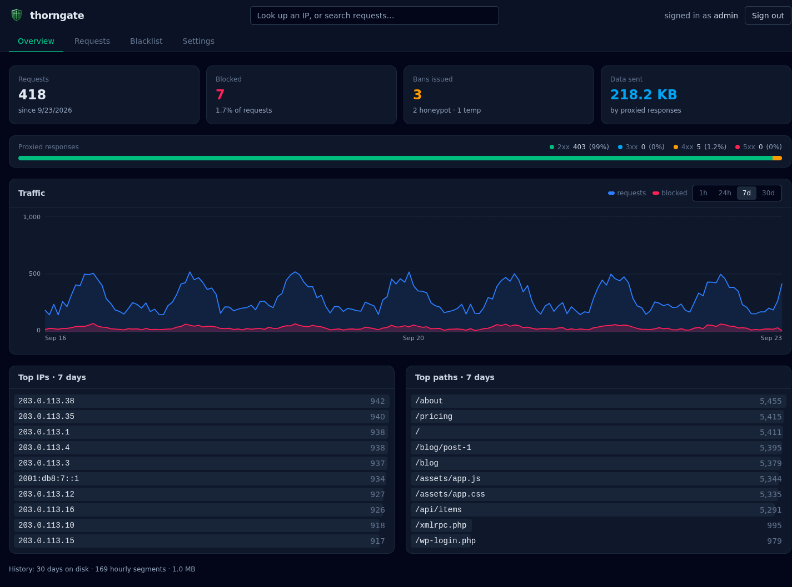
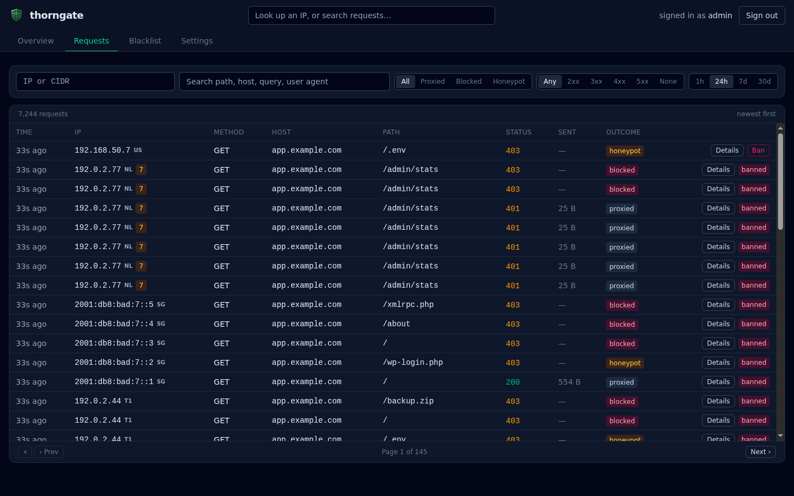
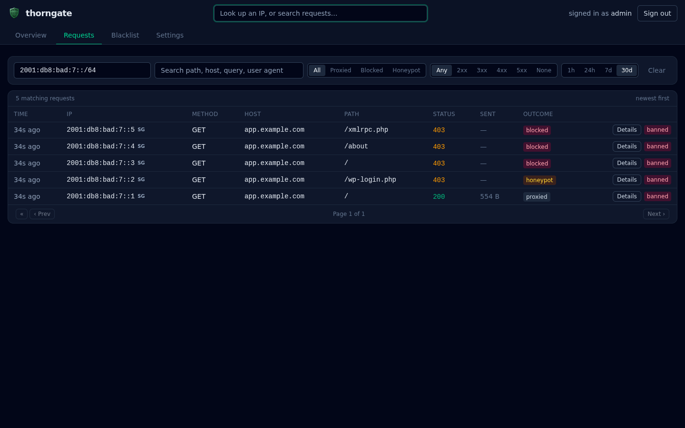
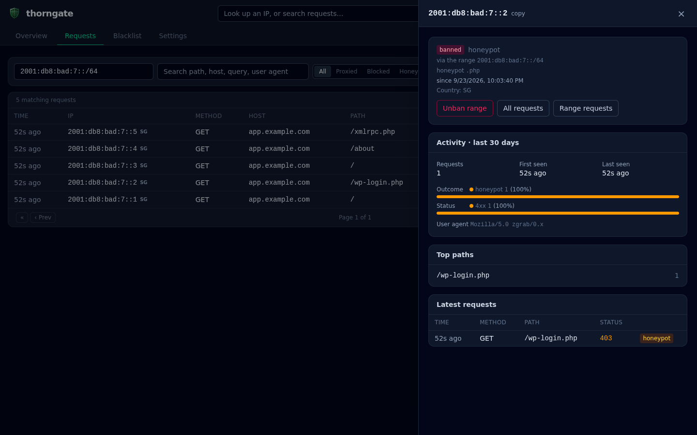
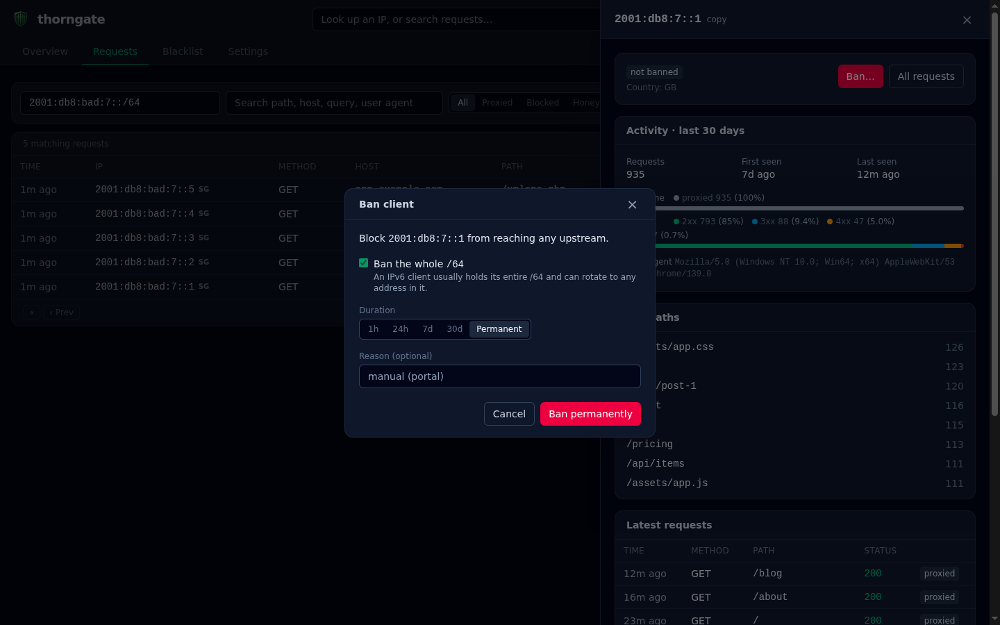
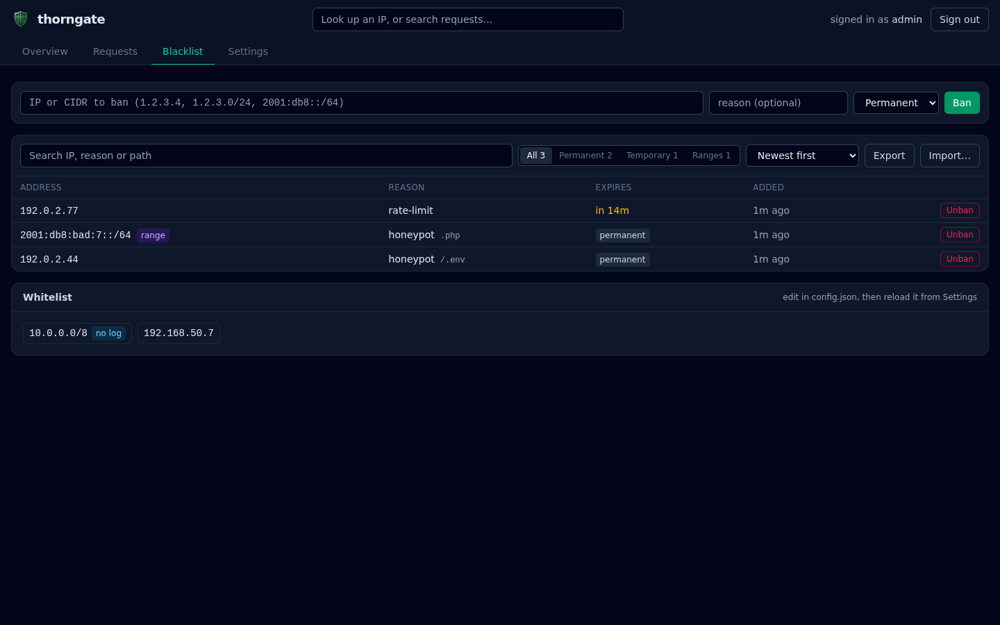
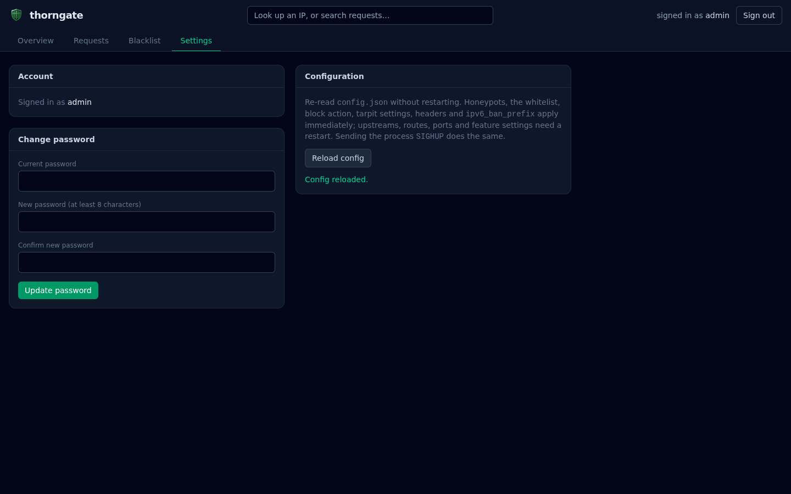
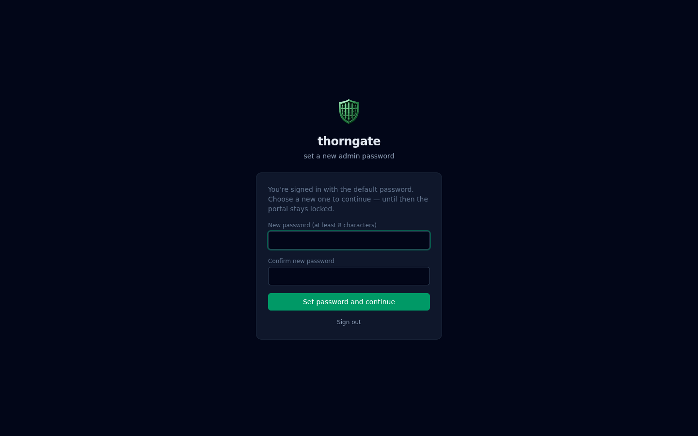

<p align="center">
  
</p>

# thorngate

A tiny, zero-dependency Go reverse-proxy WAF that sits behind a **Cloudflare Tunnel** and in front of your web/API services — a gate at the mouth of the tunnel that snags intruders. It:

- Reverse-proxies all traffic to a **default upstream**, with optional **hostname → upstream** overrides (k8s services or raw IPs), including **WebSocket / SignalR** (protocol-upgrade) connections.
- Treats configured patterns as **honeypots**. Any external IP that matches one is **blacklisted instantly** and ghosted on every future request — by default the connection is tarpitted (held open, never answered) and then dropped; `block_action` can switch this to an instant drop or a plain `403`. IPv6 clients are banned by their whole **/64**, since scanners rotate through it.
- Optionally **temp-bans** clients that rack up bad responses, and **escalates** repeat offenders to permanent bans.
- Resolves the real external IP from Cloudflare's `Cf-Connecting-Ip` header.
- Persists the blacklist to disk so it survives restarts, and can keep **weeks of searchable request history** on disk.
- Ships an optional **admin portal**: traffic overview, request search by IP / range / text, per-IP profiles, one-click bans, blocklist import/export, live config reload, and Prometheus metrics.

<p align="center">
  
</p>

Standard library only — no modules to fetch, `go build` works offline. Default listen port: **8765**.

## Request flow

```
Internet → Cloudflare → cloudflared (tunnel) → thorngate (this) → your app(s)
```

1. Read client IP from `Cf-Connecting-Ip`.
2. If IP is blacklisted → tarpit (default; or drop/403, per `block_action`).
3. If the path matches a honeypot → blacklist the IP, persist, tarpit.
4. Otherwise proxy to the route whose `host` matches, or the default upstream.

`/healthz` is reserved for k8s probes (never proxied, never a honeypot).

## Repository layout

```
.
├── cmd/thorngate/        # main entrypoint
├── internal/
│   ├── config/           # config load + honeypot matchers (+ tests)
│   ├── blacklist/        # thread-safe, file-persisted blocklist
│   ├── monitor/          # per-IP sliding-window strike counter (temp bans)
│   ├── history/          # bounded per-IP request history (dumped on ban)
│   ├── stats/            # in-memory traffic counters + history query layer
│   ├── archive/          # on-disk hourly request history (gzipped + indexed)
│   ├── auth/             # admin credential store (PBKDF2) + sessions
│   ├── admin/            # admin API + embedded React portal (internal/admin/dist)
│   └── proxy/            # IP extraction, honeypot check, host routing
├── web/                  # React + Vite source for the portal (built into admin/dist)
├── deploy/k3s/           # k3s manifests (ConfigMap, PVC, Deployment, Service)
├── .github/workflows/    # ci.yml (build/vet/test) + release.yml (GHCR image)
├── Dockerfile            # distroless, multi-arch
└── config.json           # example config
```

## Config (`config.json`)

| field | meaning |
|-------|---------|
| `listen` | listen address, default `:8765` |
| `client_ip_header` | header with the real IP — `Cf-Connecting-Ip` for Cloudflare |
| `country_header` | header with the client's country code, recorded in the request feed — default `Cf-Ipcountry` (Cloudflare sets it when IP geolocation is on) |
| `ipv6_ban_prefix` | automatic bans of an IPv6 client cover its whole network of this prefix length — default `64`; `128` bans single addresses (see below) |
| `blacklist_file` | where to persist blocked IPs (mount a volume in k8s) |
| `whitelist` | IPs never blacklisted (your own IP, internal ranges) — see below |
| `whitelist_feeds` | published IP-range lists (e.g. search crawlers) fetched periodically and whitelisted — see below |
| `honeypots` | patterns that trigger an instant blacklist (see below) |
| `block_action` | what blocked clients get: `tarpit` (default, never respond), `drop`, or `forbidden` (plain 403) — see below |
| `tarpit_duration` | max time a `tarpit` connection is held, default `100s` |
| `tarpit_max` | max connections held by the tarpit at once (overflow is dropped instead), default `512` |
| `upstream` | **default** internal target for all traffic (IP / host:port / URL) |
| `routes` | optional `host` → `upstream` overrides (see Routing below) |
| `temp_ban` | optional auto-ban for too many bad responses (see below) |
| `admin` | optional login-protected admin portal + API on a separate port (see below) |
| `request_log` | per-IP request history dumped to the log on blacklist (on by default, see below) |
| `stats` | traffic counters for the admin dashboard (on by default), plus optional on-disk request history via `stats.archive` (see below) |
| `activity` | log of events outside the request flow — bans, unbans, feed updates, reloads, logins (on by default; see below) |

Unknown keys are an **error**: a typo like `"tempban"` would otherwise silently leave a protection switched off, so thorngate refuses to start instead. Most settings can be changed without a restart — see [Reloading config](#reloading-config).

### Whitelist (`whitelist`)

IPs listed here are **never** blacklisted — not by a honeypot hit, not by a temp-ban, and not even if they fall inside a banned CIDR range. Whitelisting an IP that is *already* banned lifts the ban too (after a restart to pick up the config change). Whitelist your own admin IP and internal ranges so you can't lock yourself out.

Each entry is either a **bare string** or an **object**. The address may be a single IP, a CIDR, or an octet wildcard:

```json
"whitelist": [
  "9.9.9.9",                                   // single IP
  "107.214.211.0/24",                          // CIDR — the standard way to whitelist a range
  "107.214.211.*",                             // wildcard sugar — same as 107.214.211.0/24
  "107.214.*",                                 // wildcard for a /16
  { "ip": "10.0.0.0/8", "no_log": true }       // object form: also keep this range out of logs
]
```

A range like `107.214.211.0/24` covers `107.214.211.0`–`107.214.211.255`. The wildcard forms are just shorthand: `107.214.211.*` → `/24`, `107.214.*` → `/16`, `107.*` → `/8` (the `*`s must be the trailing octets).

Set **`no_log`** on an entry (object form) to also exclude its traffic from the **stats dashboard** and **request history** entirely. Use it for your own health checks / uptime monitors that would otherwise flood the live feed. A `no_log` IP is proxied straight through with no response wrapping, so it adds zero per-request overhead.

### Whitelist feeds (`whitelist_feeds`)

Search crawlers publish the IP ranges they crawl from. List those feeds here and thorngate fetches each one on start-up and then every `interval`, whitelisting its ranges — so a legitimate crawler that wanders into a honeypot path is denied the request but **never banned**.

```json
"whitelist_feeds": [
  "https://openai.com/searchbot.json",                                   // default interval: 6h
  { "url": "https://openai.com/gptbot.json", "interval": "1h" },
  { "url": "https://developers.google.com/static/search/apis/ipranges/googlebot.json", "interval": "12h" }
]
```

- **Formats:** the `{"prefixes": [{"ipv4Prefix": "…"}, {"ipv6Prefix": "…"}]}` JSON used by OpenAI, Google and Bing, or plain text with one IP/CIDR per line (`#` starts a comment).
- **Each feed is its own group.** A successful fetch replaces that feed's ranges outright: new ranges are added, ranges the feed no longer lists are **removed from the whitelist**, and your static `whitelist` and other feeds are untouched.
- **Existing bans are lifted.** After each fetch, any ban that lies entirely inside the feed's ranges (an IP, or a narrower range) is removed from the blacklist and logged as `UNBANNED ip=… whitelisted by feed …`. A wider banned range that merely overlaps is kept — the whitelisted addresses inside it get through anyway.
- **Failures keep the last good list.** An HTTP error, a parse error or a feed with no usable ranges leaves the previous ranges in place and retries in 5 minutes (or `interval`, if shorter). Feeds are held in memory, so they're re-fetched after a restart.
- **Guard rails:** `interval` must be at least `1m`; ranges broader than IPv4 `/8` or IPv6 `/16` are ignored, so a broken feed can't whitelist the internet; responses over 4 MB are refused.
- Feeds apply on config reload: added feeds start, removed feeds stop and their ranges leave the whitelist. The portal's **Blacklist** tab shows each feed's ranges and last fetch status.

### Honeypot matching

A honeypot is either a **bare string** (prefix match) or an **object** with a `match` mode:

```json
"honeypots": [
  "/wp-admin",                                       // prefix (boundary-aware)
  { "pattern": ".php",  "match": "contains" },       // block ANY path containing .php
  { "pattern": ".env",  "match": "suffix" },         // any path ending in .env
  { "pattern": "/cgi-bin/*", "match": "glob" },      // shell-style glob (path.Match)
  { "pattern": "\\.(git|svn|hg)(/|$)", "match": "regex" }
]
```

| `match` | semantics |
|---------|-----------|
| `prefix` (default) | path starts with pattern, on a `/` boundary (`/api` ≠ `/apixyz`) |
| `contains` | pattern appears anywhere in the path — e.g. `.php` |
| `suffix` | path ends with pattern |
| `glob` | `path.Match` against the full path (`*` does **not** cross `/` — use `contains`/`suffix` for "anywhere") |
| `regex` | Go `regexp` against the full path |

- Matching is **case-insensitive** by default, since case-insensitive upstreams (IIS/ASP.NET) serve `/WP-Admin` just like `/wp-admin`. Add `"case_sensitive": true` to an object-form honeypot to opt out.
- Paths are checked both as sent and **cleaned** (`//wp-admin`, `/x/../wp-admin` and `/x\..\wp-admin` all count as `/wp-admin`), since that is what an upstream would serve.
- A honeypot that matches the site root `/` (e.g. `""`, `"/"`, `{"pattern": ".*", "match": "regex"}`) is rejected at startup — it would ban every visitor on their first request.

### IPv6 range bans (`ipv6_ban_prefix`)

An IPv6 client almost always holds an entire `/64` and can hop to any of its 2⁶⁴ addresses at will, so banning the one address that tripped a honeypot achieves nothing — the next request simply comes from `…::2`. thorngate therefore bans the client's whole network: a honeypot hit or temp-ban from `2001:db8:bad:7::2` bans `2001:db8:bad:7::/64`, and temp-ban strikes are counted per `/64` too, so a scanner rotating addresses adds up as one client.

- Default `64` (the standard allocation for a single subscriber). Set `128` to ban single addresses, or e.g. `56`/`48` to be more aggressive.
- IPv4 is unaffected — single addresses, always.
- A whitelisted IPv6 client never bans its range on its own account, and stays reachable even if its range is banned for someone else's behaviour.
- Range bans are cheap: ranges are grouped by prefix length, so a lookup costs one map probe per distinct prefix length no matter how many ranges are banned.

### Block action (`block_action`)

A blocked client (blacklisted IP or honeypot hit) is **tarpitted by default**: thorngate never responds at all, holding the connection open until the client gives up or `tarpit_duration` elapses, then dropping it. Set `block_action` to change what blocked clients get:

```json
"block_action": "tarpit",       // "tarpit" (default) | "drop" | "forbidden"
"tarpit_duration": "100s",      // tarpit only: max hold per connection
"tarpit_max": 512               // tarpit only: max connections held at once
```

| action | behavior |
|--------|----------|
| `tarpit` (default) | never respond: hold the connection open until the client gives up or `tarpit_duration` elapses, then drop it |
| `drop` | close the connection immediately without writing any response |
| `forbidden` | respond with a plain `403 Forbidden` |

`tarpit` is the nastiest for scanners — their worker sits waiting on a socket that will never answer, while on thorngate's side the held request is just one parked goroutine doing no work. Two caps bound the cost: `tarpit_duration` (default `100s`, roughly Cloudflare's own origin timeout) limits how long each connection is held, and `tarpit_max` (default `512`) limits how many are held at once — past it, blocked requests are dropped immediately instead, so a flood can never exhaust file descriptors.

Requests denied without a response show up in the admin dashboard's request feed with **`tarpit`** or **`dropped`** in the Status column instead of a status code (a tarpit that overflowed `tarpit_max` records as `dropped`, since that's what actually happened).

**Behind Cloudflare the attacker never sees raw silence** — the connection thorngate drops belongs to `cloudflared`, so Cloudflare converts a `drop` into an immediate `502`-style error page and a `tarpit` into a `524` after its ~100s origin timeout. The `403` fingerprint is hidden either way, and `tarpit` still stalls the scanner for the full wait.

### Routing

All traffic is proxied to the single default `upstream`. `routes` are **optional** hostname overrides — a request whose `Host` matches a route goes to that route's upstream, everything else falls through to the default.

```json
"upstream": "10.0.0.10:8080",
"routes": [
  { "host": "api.example.com",            "upstream": "10.0.0.5:3000" },
  { "host": "*.internal.example.com",     "upstream": "10.0.0.6:9000" }
]
```

- Upstream values accept an **IP**, **host:port**, or **full URL** — scheme defaults to `http` (`10.0.0.5:3000` → `http://10.0.0.5:3000`).
- `host` matches the request `Host` header (case-insensitive, port ignored).
- A leading `*.` is a wildcard: `*.example.com` matches `a.example.com` and `a.b.example.com`, but **not** the apex `example.com` (add an explicit route for that).

If you only need a single backend, just set `upstream` and omit `routes` entirely.

**Protocol upgrades** (WebSocket, SignalR) pass through transparently — thorngate hijacks the connection and hands it to the upstream, so long-lived bidirectional streams work without extra config. Upgraded connections are recorded as a `101` status for temp-ban/history accounting.

### Temporary bans (`temp_ban`)

Honeypots are an *instant, permanent* ban. `temp_ban` is the softer, optional layer: it watches the **response codes** your upstreams return and **temporarily** blacklists an IP that produces too many bad ones — e.g. a scanner racking up 404s.

```json
"temp_ban": {
  "enabled": true,
  "status_codes": [401, 403, 404, 429],
  "max": 20,
  "window": "1m",
  "ban_duration": "15m"
}
```

| field | meaning | default |
|-------|---------|---------|
| `enabled` | turn the feature on | `false` |
| `status_codes` | which response codes count as "bad" | `[401, 403, 404, 429]` |
| `max` | bad responses allowed within `window` before a ban | `20` |
| `window` | sliding counting window (Go duration) | `"1m"` |
| `ban_duration` | how long the temporary ban lasts (Go duration) | `"15m"` |
| `escalate_after` | make it **permanent** once the same IP (or IPv6 range) has been temp-banned this many times within `escalate_window`; `0` disables | `0` |
| `escalate_window` | look-back for `escalate_after` (Go duration) | `"24h"` |

- Bans **auto-expire** after `ban_duration` (removed on the IP's next request or by a once-a-minute sweep, and dropped on restart if already lapsed).
- `window` and `ban_duration` must be positive durations; config loading fails otherwise.
- **Escalation** catches scanners that simply wait out each temp-ban: with `"escalate_after": 3`, the third temp-ban within 24h becomes a permanent `repeat-offender` ban (logged as `ESCALATED`, counted in the dashboard and `/metrics`).
- Whitelisted IPs are never temp-banned; a honeypot (permanent) ban always outranks a temporary one.
- Omit the whole `temp_ban` block to disable it (zero overhead — responses aren't even wrapped).

### Request history on blacklist (`request_log`)

When an IP trips a honeypot (or a temp-ban), the requests it made *just before* getting blocked are often the most useful signal — the recon and probing that led up to the trap. Thorngate keeps a short, in-memory ring buffer of the last few requests each client IP made while it was still allowed through, and dumps them to the log the moment that IP is blacklisted:

```
BLACKLISTED ip=9.9.9.9 honeypot=/wp-admin ua="curl/7.64.1" total=6
  history ip=9.9.9.9 reason=honeypot 1/3 at=2026-06-14T12:34:55Z method=GET host="app.example.com" path="/" query="" upstream="http://10.0.0.5:8080" status=200 ua="curl/7.64.1"
  history ip=9.9.9.9 reason=honeypot 2/3 at=2026-06-14T12:34:56Z method=GET host="app.example.com" path="/robots.txt" query="" upstream="http://10.0.0.5:8080" status=404 ua="curl/7.64.1"
  history ip=9.9.9.9 reason=honeypot 3/3 at=2026-06-14T12:34:57Z method=GET host="app.example.com" path="/.env" query="" upstream="http://10.0.0.5:8080" status=404 ua="curl/7.64.1"
```

It is **on by default** with sensible bounds — disable or tune it with a `request_log` block:

```json
"request_log": {
  "disabled": false,
  "depth": 10,
  "max_ips": 4096,
  "ttl": "15m"
}
```

| field | meaning | default |
|-------|---------|---------|
| `disabled` | turn the feature off entirely (zero overhead) | `false` |
| `depth` | how many recent requests to keep per IP | `10` |
| `max_ips` | cap on distinct IPs tracked; least-recently-active is evicted past this | `4096` |
| `ttl` | drop history for IPs idle longer than this (Go duration) | `"15m"` |

- Every request that reaches an upstream is recorded (any response code), so probing that returned `404`/`401` — usually the telling part — is captured too. The honeypot request itself isn't proxied, so it never appears in its own history.
- Memory is bounded on both axes (`depth` × `max_ips`) and idle IPs are swept on the `ttl` interval, so a flood of distinct sources can't exhaust memory. An IP's history is freed immediately once it's been logged.
- History lives in memory only — it is **not** persisted to the blacklist file; restart and it's gone.

### Traffic stats (`stats`)

thorngate keeps lightweight in-memory counters so the admin **Dashboard** can show traffic at a glance: total requests, requests blocked by the blacklist, honeypot bans, temp-bans, a 2xx/3xx/4xx/5xx breakdown of proxied responses, and total **data sent** (response bytes written to clients by proxied requests), plus a per-minute requests-vs-blocked chart and a **paginated feed of the last 24 hours of requests** (time, IP, method, host, path + query, the upstream it was routed to, status, bytes sent, and outcome — `proxied` / `blocked` / `honeypot`). The host and upstream columns make it easy to spot routing problems — e.g. a hostname that isn't matching its route and falling through to the default upstream.

It is **on by default** — the headline totals are lock-free atomics and the time series is a small per-minute ring buffer, so the overhead is a few increments per request. Disable or tune it with a `stats` block:

```json
"stats": {
  "disabled": false,
  "window_minutes": 60,
  "recent_requests": 5000,
  "file": "/data/stats.json",
  "save_interval": "1m"
}
```

| field | meaning | default |
|-------|---------|---------|
| `disabled` | turn the feature off entirely (zero overhead; the dashboard reports stats as off) | `false` |
| `window_minutes` | how many minutes the traffic-over-time chart covers | `60` |
| `recent_requests` | cap on how many recent requests the 24-hour request feed can hold (~1 MB at the default); set negative to omit the feed | `5000` |
| `file` | when set, counters + series + the recent-requests feed are saved here periodically (and on graceful shutdown) and loaded back at startup, so the dashboard survives restarts. Point it at a persistent volume. Empty keeps stats memory-only | *(empty)* |
| `save_interval` | how often the stats file is rewritten (Go duration); ignored when `file` is empty | `"1m"` |

- Without `file`, counters live in memory only and reset to zero on restart. With it, at most the last `save_interval` of traffic is lost on a crash (a graceful shutdown saves on exit). Saving happens on a background timer, never on the request path.
- Read them programmatically via `GET /admin/stats` (counters + series) and `GET /admin/requests` (the searchable request feed) — same bearer token as the rest of the admin API.

#### Request history on disk (`stats.archive`)

The in-memory feed only holds the last few thousand requests. Add an `archive` block to keep **weeks of searchable history** on disk instead — without holding it in memory:

```json
"stats": {
  "archive": { "dir": "/data/requests", "retention_days": 30 }
}
```

| field | meaning | default |
|-------|---------|---------|
| `dir` | directory for the hourly segment files (required; point it at a persistent volume) | — |
| `retention_days` | days of history to keep; older hours are deleted | `30` |

How it works — standard library only, no database:

- Every observed request is appended as one JSON line to the current hour's file (`2026-09-23T14.jsonl`). Appends go through a buffered queue to a single writer goroutine, so the request path never waits on disk; if the writer ever falls behind, events are dropped and counted (dashboard + `thorngate_archive_dropped_total`) rather than slowing traffic.
- When the hour closes, its file is **gzipped** (JSON compresses roughly 8–10×) and a small **index** is written beside it: request totals plus per-IP and per-path counts. Searching an IP reads the indexes and opens only the hours that IP appears in; top talkers and the long-range traffic chart come straight from indexes.
- Crash-safe: sealing writes to temp files and renames them, so an interrupted seal is simply redone at the next start, and a torn final line from a crash is skipped.
- Sizing: an event is ~200 bytes of JSON, ~25 bytes gzipped. 1M requests/day ≈ 25 MB/day on disk; typical homelab traffic stays well under a few MB for 30 days. With an archive the in-memory feed defaults to 1,000 events (it only needs the live tail).

### Activity log (`activity`)

Alongside the request log, thorngate keeps an **activity log** of things that happen outside normal request handling, shown on the portal's **Activity** tab:

| category | events |
|---|---|
| `ban` | honeypot bans, temp-bans, escalations to permanent, bans and imports from the portal |
| `unban` | unbans from the portal, expired temp-bans swept, bans lifted because a whitelist feed now covers them |
| `feed` | whitelist feed loaded / changed (`+added, -removed`), fetch failures (once per outage, not every retry) and recovery, feeds removed from the config |
| `config` | reloads, including settings that still need a restart, and failed reloads |
| `auth` | admin logins, failed logins, lock-outs, logouts, password changes |
| `system` | start-up (with version) and shutdown, stats save failures |

Each event has a time, level (`info` / `warn` / `error`), message, the IP or range it concerns, and who caused it (admin user, `api token`, feed URL, `honeypot`, `temp-ban`, `system`).

```json
"activity": { "max_events": 1000, "file": "/data/activity.jsonl" }
```

| field | meaning | default |
|---|---|---|
| `disabled` | turn the activity log off | `false` |
| `max_events` | how many recent events are kept | `1000` |
| `file` | persist events (JSON lines) so they survive restarts; the file is compacted back to `max_events` whenever it doubles | memory-only |

### Admin portal (`admin`)

An optional admin server on a **separate port** hosts the portal: a **React single-page app** (embedded into the binary via `go:embed`, so no CDN and no runtime dependencies) plus the JSON API it talks to. Changes hit the in-memory store and are persisted immediately — no restart.

- **Overview** — headline counters, the proxied-response status mix, a traffic chart (live per-minute for the last hour, or hourly for 24h / 7d / 30d from the archive) with hover details, and the top IPs and paths for the selected range.
- **Requests** — the request log, searchable by **IP or CIDR range**, free text (path, host, query, user agent), outcome, status class and time range. Rows show country, a request-count badge for chatty IPs and a `banned` marker; only page 1 refreshes live, so older pages don't shift while you read.
- **IP panel** — click any IP anywhere (or type one into the header search) for its profile: ban or whitelist status (including a covering range ban), first/last seen, outcome and status breakdowns, top paths, user agent and latest requests, with **Ban** / **Unban** / **All requests** / **Range requests** actions.
- **Ban dialog** — ban for 1h / 24h / 7d / 30d or permanently, with a reason; for an IPv6 address it offers the whole `/64`.
- **Blacklist** — search, filter (permanent / temporary / ranges), sort, confirmed unbans, time-to-expiry for temp bans, **export** to JSON and **import** from a thorngate export or any one-IP-per-line blocklist; plus a read-only view of the whitelist and each whitelist feed's ranges.
- **Activity** — the [activity log](#activity-log-activity): bans, unbans, feed updates, reloads and logins, filterable by type and level and searchable.
- **Settings** — change the admin password, and **reload the config** live.

The running version is shown in the bottom-right corner of the portal.

| | |
|---|---|
|  |  |
| **Requests** — the searchable log | Filtered to one scanner's `/64` |
|  |  |
| **IP panel** — profile of a range-banned client | **Ban dialog** — duration, reason, whole /64 |
|  |  |
| **Blacklist** — filters, export / import, whitelist | **Settings** — password and live config reload |

```json
"admin": {
  "enabled": true,
  "listen": ":9000",
  "credentials_file": "/data/admin_credentials.json",
  "token": "optional-legacy-api-token",
  "disable_metrics": false
}
```

- **Login.** The portal authenticates with a username + password. A fresh install seeds **`admin` / `admin`**, and until that password is changed the portal is **locked to a set-a-new-password screen** (the API answers `403` with `"must_change": true` for everything else) — new passwords need at least 8 characters and can't be the default. Credentials files written by older versions that still hold the default password are detected and locked the same way. The username and a salted **PBKDF2-HMAC-SHA256** hash of the password are stored in `credentials_file` (default `admin_credentials.json`, relative to the working directory — **point it at a persistent volume like `/data/admin_credentials.json`** so the change survives restarts). thorngate refuses to start if this file can't be written, and a password change that can't be saved to disk fails with an error instead of silently living in memory only. Sessions are opaque tokens held in memory with a sliding 12-hour TTL; they do not survive a restart. Changing the password signs out every other session. After **5 consecutive failed logins**, login is refused (`429` with `Retry-After`) for 30s, doubling with each further failure up to 15 minutes; a successful login resets it. The legacy `token` keeps working during a lockout.
- **`token`** is an **optional** legacy bearer token for scripted/API access, accepted alongside interactive login (and not subject to the password-change lock). Leave it empty (or set it via **`THORNGATE_ADMIN_TOKEN`**) to disable it and rely solely on login.
- **Metrics.** `GET /metrics` serves Prometheus text metrics — request/blocked/ban counters, responses by status class, bytes sent, blacklist size, tarpitted connections, archive size and drops. It is **unauthenticated** (scrapers rarely carry credentials) and exposes only counters; set `"disable_metrics": true` to turn it off.
- **Keep this port cluster-internal — never attach it to the Cloudflare tunnel.** In k3s it's a separate ClusterIP `Service` (`thorngate-admin`); reach it with port-forward.

<p align="center">
  
</p>

```bash
kubectl -n thorngate port-forward svc/thorngate-admin 9000:9000
# then open http://localhost:9000/ — first sign-in is admin / admin, then set a real password
```

API (session token from `/admin/login`, or the legacy bearer token, sent as `Authorization: Bearer <token>`). Time ranges (`range=`) accept Go durations or days: `1h`, `24h`, `7d`, `30d`.

| method | path | body | action |
|--------|------|------|--------|
| `POST` | `/admin/login` | `{"username":"...","password":"..."}` | log in → `{"token":"...","username":"...","must_change":bool}` |
| `POST` | `/admin/logout` | — | invalidate the current session |
| `GET` | `/admin/me` | — | current username, `must_change` and the running `version` (validates the session) |
| `POST` | `/admin/password` | `{"current_password":"...","new_password":"..."}` | change the admin password |
| `GET` | `/admin/blacklist` | — | list active entries (JSON) |
| `POST` | `/admin/blacklist` | `{"ip":"1.2.3.4","reason":"...","duration":"24h"}` | ban an IP or CIDR range; `duration` empty or `"permanent"` bans for good |
| `DELETE` | `/admin/blacklist/{key}` | — | unban an IP or CIDR range |
| `GET` | `/admin/blacklist/export` | — | download all active entries as JSON |
| `POST` | `/admin/blacklist/import` | JSON array (as exported) **or** plain text, one IP/CIDR per line | bulk-add bans with a single disk write → `{"added":n,"skipped":n,"invalid":[...]}` |
| `GET` | `/admin/whitelist` | — | the current whitelist |
| `GET` | `/admin/whitelist/feeds` | — | each whitelist feed: `url`, `interval`, `prefixes`, `last_fetch`, `last_ok`, `error` |
| `POST` | `/admin/reload` | — | re-read the config file → `{"ok":true,"restart_required":[...]}` |
| `GET` | `/admin/activity?category=&level=&q=&page=1&page_size=50` | — | activity log, newest first: `category` is `ban`/`unban`/`feed`/`config`/`auth`/`system`, `level` is `info`/`warn`/`error`, `q` searches message, IP and actor |
| `GET` | `/admin/stats` | — | traffic counters + per-minute series + archive info (`{"enabled":false}` if stats are off) |
| `GET` | `/admin/requests?ip=&q=&outcome=&status=&range=24h&page=1&page_size=50` | — | request history, newest first: `ip` is an IP or CIDR, `q` searches path/host/query/user agent, `outcome` is `proxied`/`blocked`/`honeypot`, `status` is `2xx`..`5xx`/`none`; `page_size` max 200. Includes per-IP counts and which IPs are banned. (`/admin/stats/recent` is an alias.) |
| `GET` | `/admin/top?range=24h&n=10` | — | busiest IPs and paths |
| `GET` | `/admin/hourly?range=7d` | — | requests / blocked per hour |
| `GET` | `/admin/ip/{ip}?range=30d` | — | one client's profile: ban (incl. covering range), whitelisted, traffic summary |
| `GET` | `/metrics` | — | Prometheus metrics (**no auth**; see above) |
| `GET` | `/` (+ assets) | — | the React portal |

The ban key may be a single IP (`1.2.3.4`) or a CIDR range (`1.2.3.0/24`, `2001:db8::/64`) — a range bans every address it contains, which is useful when an attacker rotates through a subnet. A whitelisted IP is never blocked, even if it falls inside a banned range. Addresses are normalized, so `2001:DB8::1` and `2001:db8:0::1` are the same entry.

```bash
# Log in and reuse the session token, or set TOKEN to your legacy admin.token.
TOKEN=$(curl -s -d '{"username":"admin","password":"your-password"}' localhost:9000/admin/login | sed 's/.*"token":"\([^"]*\)".*/\1/')
curl -H "Authorization: Bearer $TOKEN" localhost:9000/admin/blacklist
curl -H "Authorization: Bearer $TOKEN" -d '{"ip":"1.2.3.4"}' localhost:9000/admin/blacklist
curl -H "Authorization: Bearer $TOKEN" -d '{"ip":"1.2.3.0/24","duration":"7d"}' localhost:9000/admin/blacklist
curl -H "Authorization: Bearer $TOKEN" -X DELETE localhost:9000/admin/blacklist/1.2.3.4
curl -H "Authorization: Bearer $TOKEN" --data-binary @blocklist.txt localhost:9000/admin/blacklist/import
curl -H "Authorization: Bearer $TOKEN" "localhost:9000/admin/requests?ip=2001:db8:bad:7::/64&range=7d"
```

### Reloading config

Send the process `SIGHUP` (or use **Settings → Reload config** / `POST /admin/reload`) to re-read the config file without dropping connections. **Honeypots, the whitelist, `whitelist_feeds`, `block_action`, tarpit settings, `client_ip_header`, `country_header` and `ipv6_ban_prefix`** apply immediately. Changes to `listen`, `upstream`, `routes`, `temp_ban`, `request_log`, `stats`, `activity`, `admin` or `blacklist_file` are reported as needing a restart. A config that fails to load is rejected and the running config is kept.

The container image is distroless (no shell or `kill`), so in k3s reload through the admin API:

```bash
kubectl -n thorngate port-forward svc/thorngate-admin 9000:9000 &
curl -X POST -H "Authorization: Bearer $TOKEN" localhost:9000/admin/reload
```

#### Rebuilding the portal

The built app lives in `internal/admin/dist/` and is committed, so `go build` needs no Node toolchain. To change the UI, edit the source under `web/` and rebuild:

```bash
cd web
npm install        # first time only
npm run build      # type-checks, then builds straight into internal/admin/dist/
npm run dev        # optional: Vite dev server on :5173, proxying /admin to :9000
```

## Run locally

```bash
go build -o thorngate ./cmd/thorngate
./thorngate -config config.json   # listens on :8765
./thorngate -version              # prints the build version

# simulate a Cloudflare request that trips the ".php contains" honeypot
# (default block_action is tarpit — curl hangs until tarpit_duration, then the
#  connection drops with no response; set "block_action": "forbidden" for a 403)
curl -m 5 -H "Cf-Connecting-Ip: 9.9.9.9" http://localhost:8765/x/shell.php   # hangs, IP now blocked
curl -m 5 -H "Cf-Connecting-Ip: 9.9.9.9" http://localhost:8765/             # ghosted forever

go test ./...   # exercises the matchers
```

## CI / release

- **`ci.yml`** runs `go vet`, `go build`, and `go test` on every push/PR.
- **`release.yml`** builds a multi-arch (amd64 + arm64) image and pushes it to **GHCR** on a `vX.Y.Z` tag (or manual dispatch), stamping the tag in as the version (`-X main.version`, via the Dockerfile's `VERSION` build arg). Image: `ghcr.io/<owner>/<repo>`. Tag and push to publish:

```bash
git tag v0.1.0 && git push origin v0.1.0
```

## Deploy to k3s

Edit the image ref and your upstream service names in `deploy/k3s/thorngate.yaml`, then:

```bash
kubectl apply -f deploy/k3s/thorngate.yaml
```

The blacklist, credentials and (if enabled) the request archive are stored on a `PersistentVolumeClaim` (k3s `local-path` default StorageClass) — size it for `stats.archive` history if you enable that (the manifest requests 1Gi). Runs as a single replica with the `Recreate` strategy because the store is in-memory + a local file. The image is multi-arch, so it runs on amd64 and arm64 (e.g. Raspberry Pi) nodes.

### Point cloudflared at it

```yaml
ingress:
  - hostname: example.com
    service: http://thorngate.thorngate.svc.cluster.local:80
  - service: http_status:404
```

cloudflared automatically sets `Cf-Connecting-Ip`, which is how thorngate identifies the real client.

## Security notes

- **Keep the Service `ClusterIP`-only.** Never expose it via LoadBalancer/Ingress. The `Cf-Connecting-Ip` header is trusted, so anything that can reach thorngate directly could spoof it. Because only the in-cluster `cloudflared` can reach a ClusterIP service, the header is trustworthy in this topology.
- Always `whitelist` your own admin IP and internal CIDRs so you can't lock yourself out.

## Scaling beyond one replica

The blacklist is per-pod (in-memory + local file). To run multiple replicas, replace the file store in `internal/blacklist` with a shared backend (Redis `SET`/`SISMEMBER` is a ~30-line swap) so all pods see the same blocklist.

## License

[MIT](LICENSE) © 2026 Tim Dodd
